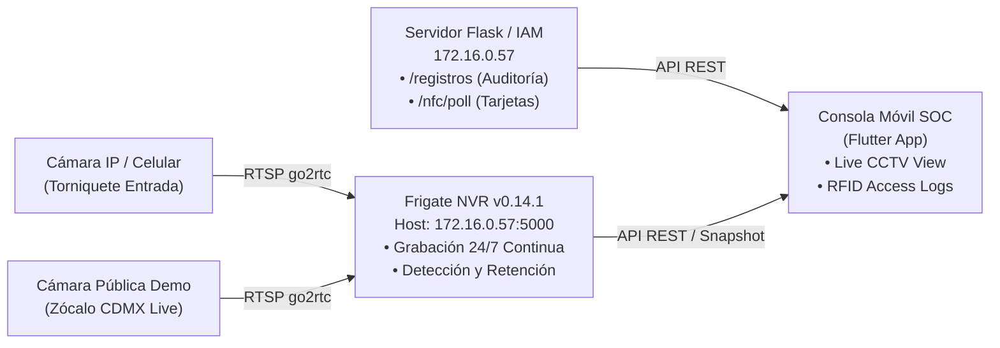

# SOC Data Center Monitoring Console (Mobile App)
> **Identity and Access Management Project — Unit 2**  
> **Universidad Politécnica de Yucatán (UPY)**  
> **Module: Security Team / Monitoring (SOC Department)**

---

## 📋 Resumen del Módulo

Esta aplicación móvil forma parte del sistema de seguridad física y lógica del Data Center empresarial simulado en el proyecto. Actúa como la **Consola del Centro de Operaciones de Seguridad (SOC)**, permitiendo a los operadores monitorear en tiempo real las instalaciones críticas, supervisar el NVR con grabación continua 24/7 y auditar los accesos físicos por tarjeta RFID coordinados con el sistema IAM (OneLogin / Microsoft 365).

---

## 🏗️ Topología del Sistema (Monitoring Department)



---

## 🎨 Paleta de Colores Oficial (Design System)

La interfaz utiliza rigurosamente el sistema de diseño corporativo especificado por el equipo:

| Token / Elemento | Código HEX | Rol en la Interfaz |
| :--- | :---: | :--- |
| **Fondo Principal** | `#F7F7F8` | Fondo general de la aplicación |
| **Superficies** | `#FFFFFF` | Tarjetas de auditoría, paneles de métricas, modales |
| **Sidebar / Barra Superior** | `#202124` | Barra superior del SOC (Dark Charcoal corporativo) |
| **Bordes y Divisores** | `#E3E4E8` | Contorno de tarjetas, chips y líneas de separación |
| **Azul de Acción / Progreso**| `#146EF5` | Botón "Iniciar Monitoreo", "Simular Pase", chips activos |
| **Estado Éxito (Success)** | `#23834A` | Estado `FRIGATE: ONLINE`, accesos RFID `GRANTED (LED Verde)` |
| **Estado Advertencia (Warning)**| `#C35B17` | Cámaras inactivas, modo demo o standby |
| **Estado Peligro (Danger)** | `#C91C2B` | Grabación `REC 24/7`, alertas de intrusión `DENIED (LED Rojo)` |

---

## 📹 Cámaras y Endpoints del NVR (Frigate 0.14.1)

El servidor Frigate corre en la red local en `http://172.16.0.57:5000` con `auth.enabled: false`:

* **`cam_entrada`**: Cámara del torniquete de entrada RFID. Estado: **Habilitada** (`enabled: true`). Stream RTSP: `rtsp://172.16.0.57:8554/cam_entrada`.
* **`zocalo_cdmx`**: Flujo de prueba continuo en vivo. Estado: **Habilitada** (`enabled: true`). Stream RTSP: `rtsp://172.16.0.57:8554/zocalo_cdmx`.
* **`cam_interior`**: Cámara del área de racks. Estado: **Deshabilitada temporalmente** (`enabled: false`), reflejada como inactiva en la UI.
* **Consulta de configuración:** `GET /api/config`
* **Telemetría y FPS:** `GET /api/stats`
* **Snapshots en vivo:** `GET /api/<camara>/latest.jpg?h=480`

---

## 🚀 Cómo Ejecutar la Aplicación

### Requisitos
* Flutter SDK (3.x o superior)
* Conexión a la red local del laboratorio o módem compartido

### Pasos
1. Clonar o abrir la carpeta del proyecto:
   ```bash
   cd soc_monitoring_app
   ```
2. Obtener dependencias:
   ```bash
   flutter pub get
   ```
3. Ejecutar en el navegador (Web) o servidor de red:
   ```bash
   # En navegador local
   flutter run -d chrome

   # Servidor para abrir desde teléfonos móviles en la misma Wi-Fi
   flutter run -d web-server --web-hostname=0.0.0.0 --web-port=9000
   ```
4. Para compilar la versión Web lista para producción / Netlify:
   ```bash
   flutter build web --release
   ```

---

## 🛡️ Características Cumplidas de la Rúbrica (Monitoring - 10 Puntos)

- [x] **Topología NVR + Cámara + App Móvil:** Integración demostrada con Frigate 0.14.1, cámaras locales/remotas y aplicación móvil.
- [x] **Monitoreo Remoto en Móvil:** Conexión en tiempo real a streams de go2rtc y snapshots con baja latencia (~90ms).
- [x] **Grabación 24/7:** Configuración del NVR Frigate en modo `continuous: days: 7` (retención continua) reflejado en el banner del SOC.
- [x] **Bitácora de Control de Acceso (RFID):** Validación de los 4 usuarios autorizados (SysAdmin, Network Engineer, SOC Analyst, DBA) y detección de intrusos con simulación de estados de LED físico (Verde / Rojo).
- [x] **Evidencias Forenses:** Registro instantáneo de eventos con marca temporal y código de auditoría `EV-1000`.
